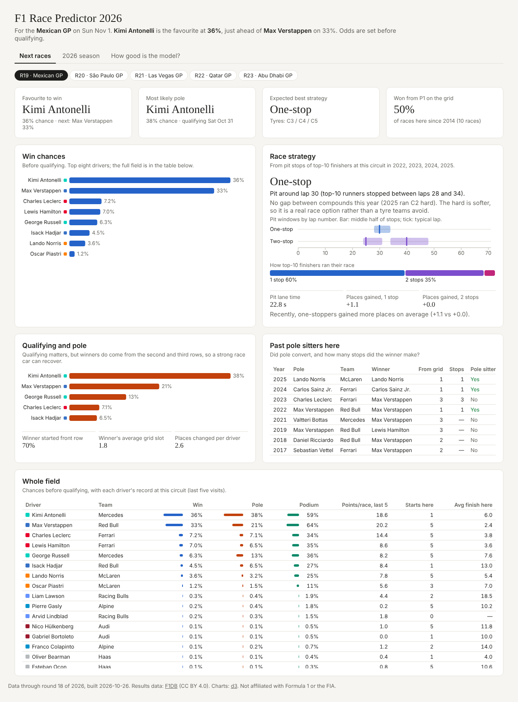
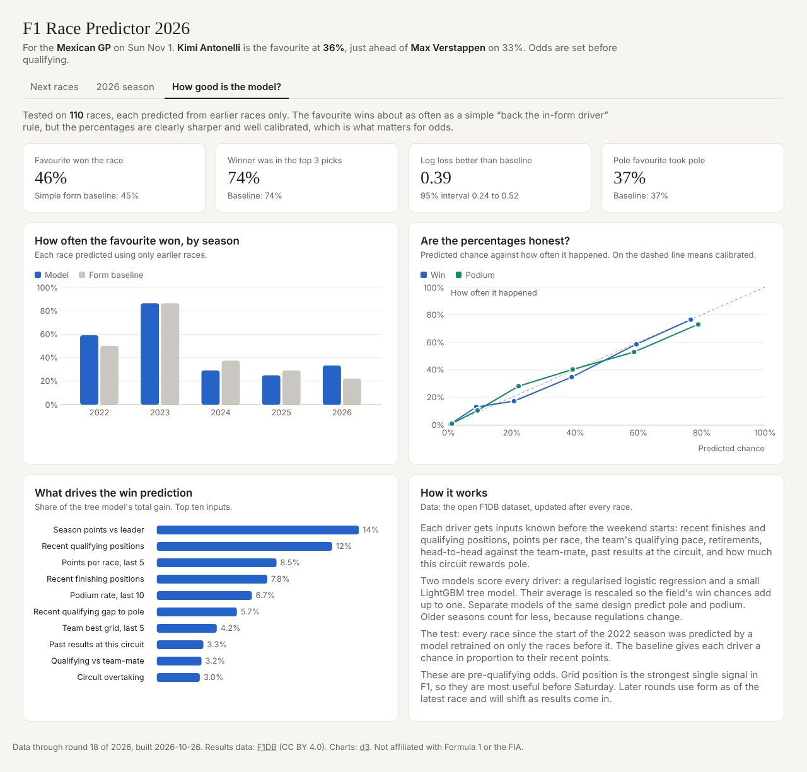
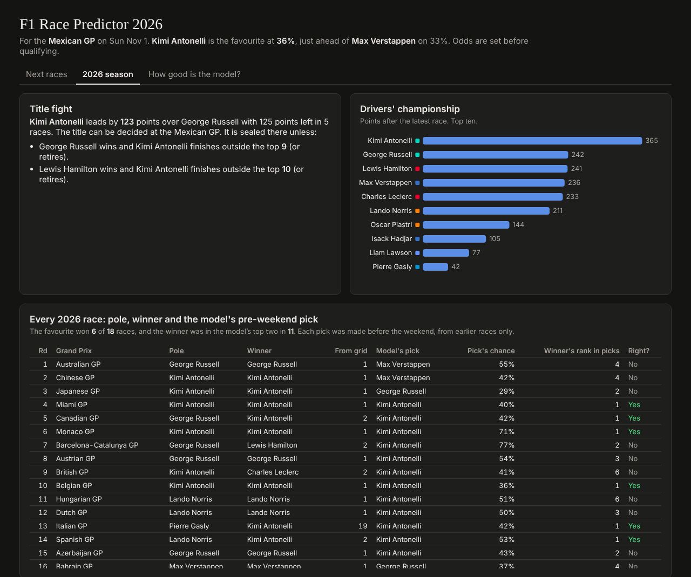
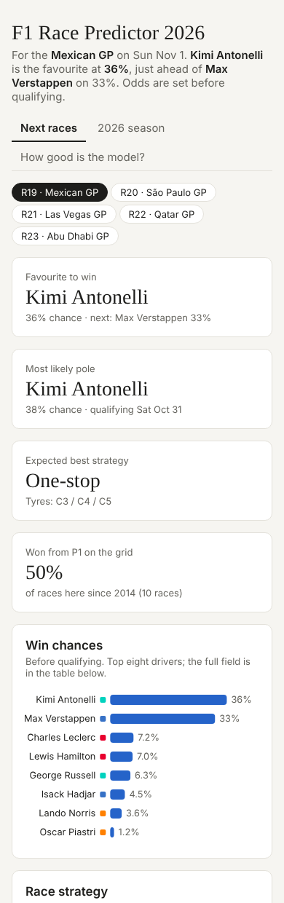

# F1 Race Predictor 2026

A machine learning model that predicts who will win the remaining races of the 2026 Formula 1 season, who takes pole, and who ends up on the podium. It also works out the likely race strategy at each circuit. Everything shows up on a web dashboard.

**[Live dashboard](https://akhusro30-maker.github.io/f1-race-predictor-2026/)**



## Why I built this

I wanted a data science project that goes all the way from raw data to something people can actually use, not just a notebook with a score at the bottom. F1 is a good fit for that. There's decades of clean public data, a new race to predict every couple of weeks, and the problem is harder than it looks. Twenty drivers compete for one win, so each driver's chances depend on everyone else's.

## What it does

- **Win, pole and podium chances** for every driver at every remaining race, made before qualifying.
- **Race strategy** for each circuit: how many stops usually works, which laps the stops happen on, how much time the pit lane costs, and Pirelli's tyre choices.
- **Qualifying importance**: how often pole actually converts at that track, and who took pole there in past years.
- **Championship maths**: what the leader needs at the next race to clinch the title.
- **An honest scorecard**: how the model did on every race since 2022, compared with a simple baseline.

## How it works

**Data.** Race results, qualifying, starting grids and pit stops come from [F1DB](https://github.com/f1db/f1db), an open database that gets updated after every race. I train on 270 races from 2014 to now.

**Features.** Each driver gets 31 inputs, all known before the race weekend starts:

- recent finishing and qualifying positions, and points per race over the last five races
- the team's qualifying pace compared with the fastest car
- retirement rate and head-to-head qualifying against the team-mate
- past results at the circuit
- how often pole wins at this track and how much the order usually changes

Several of these also appear as a rank within the field. What matters is how a driver compares to the other 19 that weekend, not the raw number.

I was careful about leakage here. Every feature for a race is built only from races that happened before it.

**Models.** Two models score every driver: a regularised logistic regression and a small LightGBM. I average them and rescale so the win chances for each race add up to 100%. Separate models of the same design predict pole and podium (podium chances add up to 300%). Older seasons count for less in training because the regulations keep changing, including the big reset in 2026.

**Strategy.** This part is stats, not ML. For each circuit I look at the pit stops of drivers who finished in the top 10 since 2022: how many stops they made, which laps they stopped on, and whether one-stoppers or two-stoppers gained more places.

## Results

I tested it walk-forward. Every race from 2022 onward was predicted by a model retrained only on the races before it, which is the same position the model is in for a real upcoming race. The baseline gives each driver a chance in proportion to their recent points.

| Over 110 races (2022 to 2026) | Model | Baseline |
|---|---|---|
| Favourite won the race | 46% | 45% |
| Winner was in the top 3 picks | 74% | 74% |
| Log loss of the actual winner (lower is better) | **1.54** | 1.92 |

The model doesn't pick the winner more often than the baseline. F1 is hard to beat on that, because "back whoever is in form" is already a strong rule. Where it does win is the percentages. The log loss improvement is 0.39 (95% bootstrap interval 0.24 to 0.52), and the probabilities are well calibrated. When it gives a driver about 60%, they won about 59% of the time.



Its 2026 record before each weekend: the favourite won 6 of 18 races, and the winner was one of its top two picks in 11.

<p>
  
  
</p>

## Run it yourself

You'll need Python 3.10+ and Git. On a Mac, run `brew install libomp` first (LightGBM needs it).

```bash
git clone https://github.com/YOUR-USERNAME/f1-race-predictor-2026.git
cd f1-race-predictor-2026

# the F1 data goes in a folder next to this one
git clone --depth 1 https://github.com/f1db/f1db ../f1db/f1db

python3 -m venv .venv
source .venv/bin/activate        # Windows: .venv\Scripts\Activate.ps1
pip install -r requirements.txt

python -m f1dash.build            # features + final models, about 2 min
python -m f1dash.export           # data for the dashboard
python -m f1dash.site             # builds site/index.html
```

Then open `site/index.html` in a browser. It's a single file with the data and charts built in, so it works offline.

`build` prints the picks for each remaining race. This was the run after the 2026 United States GP:

```
R19 mexico: kimi-antonelli 36%, max-verstappen 33%, charles-leclerc 7% | pole: kimi-antonelli
R20 sao-paulo: kimi-antonelli 31%, max-verstappen 30%, lewis-hamilton 10% | pole: kimi-antonelli
R21 las-vegas: kimi-antonelli 32%, max-verstappen 31%, lewis-hamilton 9% | pole: kimi-antonelli
R22 qatar: kimi-antonelli 31%, max-verstappen 28%, lewis-hamilton 12% | pole: kimi-antonelli
R23 abu-dhabi: kimi-antonelli 37%, max-verstappen 33%, lewis-hamilton 7% | pole: kimi-antonelli
```

**After each race weekend**, pull the new data and rebuild:

```bash
git -C ../f1db/f1db pull
python -m f1dash.build && python -m f1dash.export && python -m f1dash.site
cp site/index.html docs/index.html   # updates the live site
```

To redo the full walk-forward backtest, run `python -m f1dash.build --backtest` (about 6 minutes). Without that flag it reuses the saved results in `cache/`.

## Project structure

```
f1dash/
  load.py        reads the F1DB YAML files into pandas tables
  features.py    builds the 31 pre-race features, no look-ahead
  model.py       models, walk-forward backtest, scoring, calibration
  strategy.py    pit stop and qualifying stats per circuit, tyre choices
  build.py       runs everything and writes dashboard/data.json
  export.py      flattens it into the datasets the dashboard reads
  site.py        builds the standalone website
dashboard/       dashboard page (d3.js) and its data
site/            the built website
docs/            copy of the website for GitHub Pages
cache/           saved backtest results
```

## Limitations and what's next

- The odds are set before qualifying. Grid position is the strongest single signal in F1, so they matter most before Saturday. Next I want to add a second model that updates once the grid is known.
- Later races use form as of the latest race, so they'll shift as results come in.
- F1DB doesn't have lap times, tyre stints, weather or safety cars, so the strategy section is built from stop counts and timing. Pirelli's tyre picks are typed in by hand in `strategy.py`.
- Some ideas: practice pace from [FastF1](https://docs.fastf1.dev/), weather, and comparing the odds against betting markets.

## Credits

Data from [F1DB](https://github.com/f1db/f1db) (CC BY 4.0). Charts made with [d3.js](https://d3js.org). This is a personal project and isn't affiliated with Formula 1 or the FIA.
